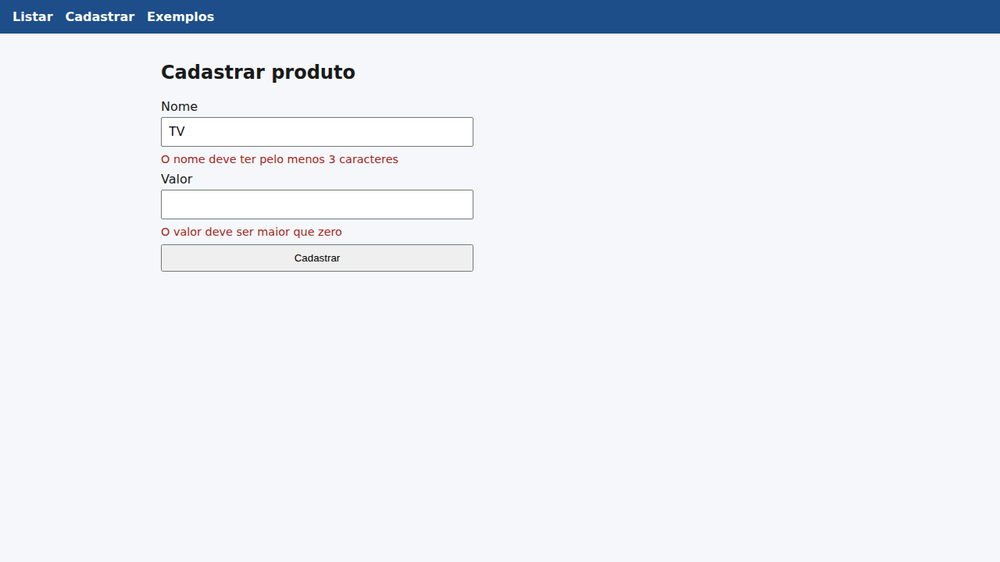
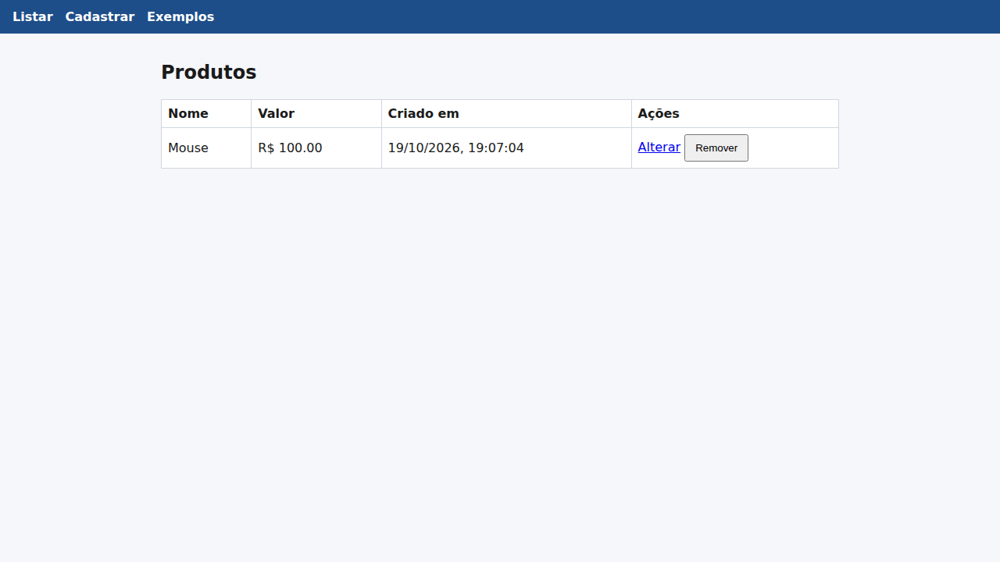

# 08 — React + API em C#: CRUD de produtos (material para as aulas de React e a Prova A1)

Material **adiantado**, que vem antes das aulas. Segue o calendário: introdução e ambiente (05/10), componentização e estado
(19/10), CRUD com a API em C# (26/10 e 09/11) e validação de formulário (16/11). Quando o professor subir o código
dele, compare com este.

```
08-React-Ecommerce/
├── API/      cópia da API do professor (pasta 07) + CORS + endpoint buscarid
└── front/    projeto React (Vite + TypeScript)
    └── src/
        ├── App.tsx                         rotas (React Router) e menu
        ├── models/Produto.ts               interface com o formato do JSON
        ├── services/api.ts                 axios com a baseURL da API
        └── components/
            ├── exemplos/Saudacao.tsx       props
            ├── exemplos/Contador.tsx       useState, input controlado, renderização condicional
            └── produto/
                ├── ProdutoListar.tsx       GET + DELETE, useEffect, map + key
                ├── ProdutoCadastrar.tsx    POST + validação de formulário
                ├── ProdutoAlterar.tsx      useParams + GET por id + PUT
                └── validacao.ts            regras de validação no front
```

## Como rodar (dois terminais)

**Pré-requisito:** [Node.js](https://nodejs.org/) LTS, além do .NET 8.

```bash
# Terminal 1: API
cd 08-React-Ecommerce/API
dotnet ef database update
dotnet run                       # http://localhost:5195

# Terminal 2: React
cd 08-React-Ecommerce/front
npm install                      # só na primeira vez (baixa o node_modules)
npm run dev                      # http://localhost:5173
```

| Validação no formulário | Listagem |
|---|---|
|  |  |

Testado no navegador: listagem vazia (mensagem 400 da API), validação, cadastro, duplicado
("Esse produto ja existe!"), alteração, remoção e o contador.

## Como o projeto foi criado

```bash
npm create vite@latest front -- --template react-ts
cd front
npm install
npm install axios react-router-dom
```

## O que mudou na API: CORS

O React roda em `localhost:5173` e a API em `localhost:5195`. São **origens diferentes**, e por segurança o
**navegador** bloqueia a resposta, a menos que a API autorize. O Postman e o REST Client não sofrem isso, porque não
são navegadores. Por isso entrou no `Program.cs`:

```csharp
builder.Services.AddCors(options =>
    options.AddPolicy("Acesso Total",
        configs => configs.AllowAnyOrigin().AllowAnyHeader().AllowAnyMethod()));
// ...
app.UseCors("Acesso Total");
app.Run();
```

Sintoma típico de CORS faltando: o console do navegador mostra *"blocked by CORS policy"* e a chamada falha, mesmo
com a API funcionando no Postman.

Também foi acrescentado `GET /api/produto/buscarid/{id}`, que a tela de alterar usa para preencher o formulário.

## Conceitos de React usados aqui

| Conceito | Onde | Resumo |
|---|---|---|
| Componente | todos | função que devolve JSX. Nome começa com **maiúscula** |
| JSX | todos | HTML dentro do JS. `className` em vez de `class`, `{expressão}` para valores |
| Props | `Saudacao` | dados do pai para o filho, **somente leitura** |
| Estado (`useState`) | `Contador`, formulários | quando muda, o componente **re-renderiza**. Nunca altere direto, use o `set...` |
| Input controlado | formulários | `value={estado}` + `onChange={e => setEstado(e.target.value)}` |
| Efeito (`useEffect`) | `ProdutoListar`, `ProdutoAlterar` | efeitos colaterais (buscar na API). `[]` = só ao montar. `[id]` = quando `id` mudar |
| Listas | `ProdutoListar` | `produtos.map(p => <tr key={p.id}>...)`. A `key` é obrigatória e única |
| Renderização condicional | vários | `{cond && <p>...</p>}` e `{cond ? a : b}` |
| Eventos | botões e forms | `onClick={() => ...}`, `onSubmit={enviar}` com `e.preventDefault()` |
| SPA + rotas | `App.tsx` | `BrowserRouter`, `Routes`, `Route`, `Link`, `useParams`, `useNavigate` |
| Requisições | `services/api.ts` | `axios.get/post/put/delete`, `async/await`, `try/catch`, `erro.response.data` |
